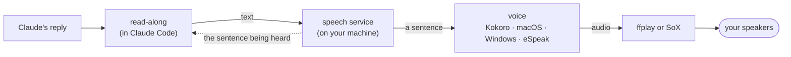

# Read-along for Claude Code

[](https://github.com/tomfluff/claude-read-along/actions/workflows/tests.yml)


[](LICENSE)

A mod for Claude Code: listen to Claude's replies while the sentence being
read is highlighted in the terminal, so you can follow along with your eyes
and ears together.

Read-along is for anyone who would rather hear long replies than read them:
people with dyslexia, low vision, ADHD or eye strain, people reading in a
second language, and anyone who wants to look away from the screen while
Claude explains something. It is not a screen reader and doesn't replace one.

- **Play any message.** Hover a message for its play, speed and voice
  buttons.
- **Follow the highlight.** The sentence being spoken is highlighted in the
  message.
- **A player above the prompt.** Pause, stop, skip back or forward, and
  change speed and voice.
- **Auto-read.** Have each reply read when it arrives, or every update Claude
  writes between tool calls too.
- **Several languages in one reply.** Japanese, Chinese, Korean, Hebrew,
  Arabic, Cyrillic, Hindi, Greek and Thai sentences each get their own voice.
- **Local and private.** Speech is made on your machine. Nothing you read is
  sent anywhere.
- **Fast without chipmunk voices.** Speeds up to 4× keep the voice's pitch.

## Hear it

Kokoro voices, made with read-along's own setup on a laptop CPU. Each link
opens a short MP3.

| Voice | Language | Sample |
|---|---|---|
| `kokoro:af_heart` | English (US) | [listen](docs/samples/en-us-heart.mp3) · [at 2× speed](docs/samples/en-us-heart-2x.mp3) |
| `kokoro:am_fenrir` | English (US) | [listen](docs/samples/en-us-fenrir.mp3) |
| `kokoro:bf_emma` | English (UK) | [listen](docs/samples/en-uk-emma.mp3) |
| `kokoro:jf_alpha` | Japanese | [listen](docs/samples/ja-alpha.mp3) |
| `kokoro:ef_dora` | Spanish | [listen](docs/samples/es-dora.mp3) |
| `kokoro:ff_siwis` | French | [listen](docs/samples/fr-siwis.mp3) |

## What you need

- **Claude Code 2.1.287 or later, in the terminal.** Read-along is a mod, a
  plugin that draws in Claude Code's interface. Mods are on by default from
  that version. They also draw in the JetBrains plugin and the desktop app's
  Code tab, but not in the desktop app's WSL sessions.
- **WSL, Linux or macOS.** Native Windows isn't supported yet; use it through
  WSL.
- **Python 3.9 or newer** as `python3`. The speech service needs only the
  standard library.
- **An audio player:** `ffplay` (comes with ffmpeg) or SoX's `play`.
- **At least one voice engine:**

| Engine | Where | Quality | Setup |
|---|---|---|---|
| **Kokoro** | everywhere | natural, neural | `/read-along setup` (about 1 GB, CPU is fine) |
| macOS voices | macOS | good (Enhanced and Premium voices are better) | built in |
| Windows voices | WSL | good with the newer "natural" voices | built in |
| eSpeak NG | Linux, WSL | robotic, but about 100 languages | `sudo apt install espeak-ng` |

Kokoro speaks English (US and UK), Japanese, Chinese, Spanish, French, Hindi,
Italian and Portuguese. Other languages use the system voices or eSpeak NG.

## Install

At the Claude Code prompt:

```
/plugin install read-along --marketplace tomfluff/claude-read-along
```

Answer `y` to add the marketplace, then pick the user scope.

Next, check what your machine has:

```
/read-along doctor
```

To get the Kokoro voices, run `/read-along setup`. It puts a request in the
prompt box; press Enter and Claude walks you through it with the mod's
setup skill, asking before it installs anything. To do it yourself instead,
run `python3 <plugin folder>/bin/setup.py kokoro` (add `--japanese` for
Japanese). Kokoro goes into its own folder,
`~/.local/share/claude-read-along` (on macOS,
`~/Library/Application Support/claude-read-along`), and nowhere else.

To see what the mod hooks and calls before you install it, clone the
repository and run `claude plugin validate .` in it.

## Using it

- **Hover a message** for its buttons: play or pause, restart, slower,
  faster, and the voice (click to step to the next voice).
- **The player** sits above the prompt. While idle it shows the voice and
  speed, plus buttons to read the last reply and open the settings. While
  reading it shows progress, pause, stop, back, forward and speed. Its buttons
  have hotkeys: `p` pause, `s` stop, `b` back, `n` next, `r` read the last
  reply, `o` settings.
- **`/read-along`** opens the settings: a voice per language, speed, volume,
  auto-read and the player's place. Changes last for the session; **save as
  defaults** keeps them.

| Command | |
|---|---|
| `/read-along read` | read the last reply |
| `/read-along stop`, `pause` | stop, or pause and resume |
| `/read-along speed 1.5` | set the speed (0.5 to 4) |
| `/read-along voice kokoro:af_heart` | set the main voice; `voice ja kokoro:jf_alpha` for Japanese |
| `/read-along voices` | list the installed voices |
| `/read-along auto replies all` | auto-read: `off`, `final` (each turn's last reply) or `all` |
| `/read-along auto mine on` | also read your own messages |
| `/read-along save` | keep this session's choices as the defaults |
| `/read-along doctor` | what works on this machine and what to install |
| `/read-along setup` | ask Claude to set up the Kokoro voices |
| `/read-along restart` | restart the speech service |

## Settings

All in `/config` under read-along.

| Setting | Default | |
|---|---|---|
| Voices | `auto` | A voice per language; see below. |
| Speed | 1.25 | 0.5 to 4. |
| Volume | 100 | Percent, 0 to 200. |
| Auto-read Claude's replies | off | `off`, `final`, `all`. |
| Auto-read my messages | off | |
| Read code blocks | off | Off says "code block" instead. |
| Highlight | `reverse` | Swaps text and background colours, which works on any theme. Or a colour: `yellow`, `#f1fa8c/#282a36` (background/text). |
| Message buttons | hover | `hover`, `glyph` (only over a ♪ at the message's right; no flashing while scrolling), `always`, `off`. |
| Player | band | `band` above the prompt, `hint` (dim text under the prompt), `message` (under the message being read), `band+message`. |
| Icons | text | `nerd` for Nerd Font media icons. |
| Lower other apps while reading | off | WSL only for now: turns music and browsers down while speaking. |

### Voices

A voice is written `engine:name`:

- `kokoro:af_heart`, `kokoro:jf_alpha`: Kokoro (the first letter is the
  language, the second the gender)
- `mac:Samantha`, `mac:Ava (Premium)`: macOS
- `win:Microsoft Aria`: Windows, from WSL
- `espeak:en-us`, `espeak:he`: eSpeak NG
- `auto`: the best voice installed for the language

The Voices setting gives each language group a list. Latin-script text is
read by `main`, and every other script by its own group (`ja`, `zh`, `ko`,
`he`, `ar`, `ru`, `hi`, `el`, `th`). The first voice in a list is the one
used; the voice button steps through the main list:

```
main=kokoro:af_heart, kokoro:bf_emma, mac:Samantha; ja=kokoro:jf_alpha; he=mac:Carmit
```

If your Latin-script text isn't English, tell `auto` which language it is:
`python3 <plugin folder>/bin/setup.py language es`.

## Privacy

The mod runs a small speech service on your machine. It is reached over a
Unix socket that only your user can open, and it sends nothing over the
network. The network is used only by setup: Python packages come from PyPI,
and Kokoro's model comes from the
[kokoro-onnx releases](https://github.com/thewh1teagle/kokoro-onnx/releases),
checked against a pinned SHA-256.

## Troubleshooting

- **Silent?** Run `/read-along doctor`, then look at the service's log:
  `/tmp/read-along-<your uid>.log`.
- **Changed something (installed a voice, ran setup)?** Run
  `/read-along restart`.
- **Crackling on WSL?** The service already uses a 300 ms audio buffer there,
  which WSLg needs. Check that nothing else is holding the audio device.
- **No buttons in the desktop or mobile app (Remote Control)?** Run
  `/read-along doctor` in the terminal. Under "Surfaces" it lists each app
  following the session and what it has asked read-along to draw; an app
  that has asked for nothing doesn't draw mods yet. On the phone the buttons
  show all the time, as there is no pointer to hover with. The voice always
  plays on the computer running the session.
- **The first read is slow.** Kokoro loads its model on the first read of a
  session (a few seconds), then keeps it until the service has been idle for
  30 minutes.

## How it works



`plugin/hooks/register.tsx` is the Claude Code side: the buttons, the highlight, the
player and the commands. `plugin/bin/speakd.py` is the speech service, shared by
every Claude Code session so only one voice talks at a time. It splits a
message into sentences, makes each one with the engines in `plugin/bin/engines.py`,
and plays them through ffplay or SoX, sped up without changing pitch.
`plugin/bin/setup.py` installs Kokoro.

## Credits and licence

MIT licence; see [LICENSE](LICENSE). Read-along uses, without bundling:
[Kokoro-82M](https://huggingface.co/hexgrad/Kokoro-82M) and
[misaki](https://github.com/hexgrad/misaki) (Apache-2.0),
[kokoro-onnx](https://github.com/thewh1teagle/kokoro-onnx) (MIT),
[eSpeak NG](https://github.com/espeak-ng/espeak-ng) (GPL-3.0, run as a
separate program), and FFmpeg or SoX for playback.
